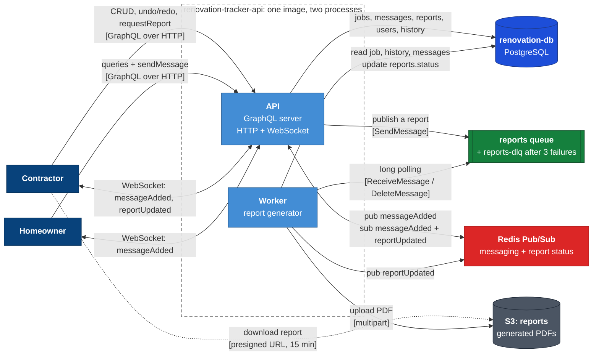

# Renovation Project Tracker API

Backend for a tool where contractors and homeowners collaborate on renovation jobs:
job CRUD with homeowners, a chat-like message log, asynchronous PDF report export,
a full change history with undo/redo, and real-time messaging.

Status: all features are complete, including job history with undo/redo and real-time
messaging over GraphQL subscriptions.

## Video walkthrough

A 15-minute walkthrough of the architecture, the main decisions and a live demo:
[watch it on Google Drive](https://drive.google.com/file/d/1aQMcSCyGoUzKuuJs6BizPTWZ0_sceWLE/view?usp=sharing).
Set the player to 1080p for the best viewing experience.

## Stack

- Node.js 22, TypeScript, pnpm
- Fastify + GraphQL Yoga, schema built code-first with Pothos
- PostgreSQL 17 with Drizzle ORM
- Redis (PubSub for GraphQL subscriptions across processes)
- AWS SQS and S3 (LocalStack locally; same SDK code against real AWS)

## Architecture

One package, two processes, one composition root.



Every arrow into Redis is a publish or a subscribe, and every arrow out of it ends at the API,
never at a user: Redis carries notifications with ids, Postgres holds the state.

- **Request path.** A GraphQL field never holds logic: it reads its arguments, calls a service and
  returns the result. Services validate input with zod, open transactions, lock rows and check
  ownership. Repositories only run SQL and receive the executor (`Db` or `Tx`) as a parameter,
  so a service composes several repositories inside one transaction.
- **Authorization in two layers.** The Pothos scope-auth plugin enforces the role per field
  (`authenticated`, `contractor`, `homeowner`). Services enforce ownership and membership, which
  needs data, and they do it for every entry point, including the worker.
- **Composition root.** `src/container.ts` is the only place that instantiates infrastructure,
  repositories and services. The API and the worker both build it, so there is exactly one wiring.
- **Infrastructure behind interfaces.** `src/infra/` defines `MessageQueue`, `ObjectStorage` and
  `ReportWriter`, each with a real implementation (SQS, S3, pdfkit) and an in-memory one for
  tests. Modules never import the AWS SDK.
- **Per-request DataLoaders** batch the lookups behind `Job.contractor`, `Job.homeowners`,
  `Message.sender` and `Message.job`, so a list of jobs costs a constant number of queries.
- **Real time.** GraphQL subscriptions run over WebSocket with the graphql-ws protocol on the
  same `/graphql` endpoint. Services publish thin events (`{ messageId }`, `{ reportId }`) to a
  Redis-backed PubSub after writing to Postgres, so the worker can notify API subscribers and
  several API instances share the same stream; resolvers load the fresh row on delivery.
- **Modules.** `users` (identity), `auth` (login and JWT), `jobs` (CRUD, soft delete,
  homeowners, optimistic locking), `messages` (chat log with keyset pagination and the
  `messageAdded` subscription), `history` (append-only timeline, undo and redo), `reports`
  (asynchronous PDF pipeline, the worker loop and the `reportUpdated` subscription).

## Quick start

```bash
cp .env.example .env
docker compose up -d          # postgres, redis, localstack
pnpm install
pnpm db:migrate
pnpm db:seed
pnpm dev                      # GraphQL API on http://localhost:4000/graphql (GraphiQL included)
pnpm dev:worker               # report worker, in another terminal
```

### Seeded accounts

| Email                   | Password        | Role       |
| ----------------------- | --------------- | ---------- |
| `alice@contractor.test` | `contractor123` | Contractor |
| `bob@homeowner.test`    | `homeowner123`  | Homeowner  |
| `carol@homeowner.test`  | `homeowner123`  | Homeowner  |

The seed is idempotent: running it again resets these accounts and leaves everything else
untouched.

`docker compose up -d` starts only the infrastructure; the API and the worker run on the host
with reload. To run everything in containers, migrations included:

```bash
docker compose --profile app up --build
```

## Environment variables

Copy `.env.example` to `.env`. Every process validates these at boot and refuses to start on a
bad value.

| Variable                                      | Purpose                                             | Local default                 |
| --------------------------------------------- | --------------------------------------------------- | ----------------------------- |
| `NODE_ENV`                                    | `development`, `test` or `production`               | `development`                 |
| `PORT`                                        | HTTP port of the API                                | `4000`                        |
| `LOG_LEVEL`                                   | pino log level                                      | `debug`                       |
| `DATABASE_URL`                                | PostgreSQL connection string                        | Compose database `renovation` |
| `REDIS_URL`                                   | Redis used as PubSub between the API and the worker | Compose Redis                 |
| `JWT_SECRET`                                  | Signs login tokens, at least 16 characters          | placeholder, change it        |
| `JWT_EXPIRES_IN`                              | Token lifetime                                      | `8h`                          |
| `AWS_REGION`                                  | Region for the AWS SDK clients                      | `us-east-1`                   |
| `AWS_ENDPOINT_URL`                            | LocalStack endpoint; leave unset to target real AWS | LocalStack                    |
| `AWS_ACCESS_KEY_ID` / `AWS_SECRET_ACCESS_KEY` | Credentials; LocalStack accepts any value           | `test`                        |
| `SQS_REPORTS_QUEUE_URL`                       | Queue consumed by the report worker                 | LocalStack queue `reports`    |
| `S3_REPORTS_BUCKET`                           | Bucket that stores generated PDFs                   | `reports`                     |

LocalStack is pinned to 4.14 because later releases require an auth token even on the free plan,
which would force anyone running the project to create a LocalStack account. Its init script
creates the `reports` queue with a dead letter queue (`reports-dlq`, three attempts) and the
`reports` bucket; the Compose healthcheck only passes once that script has finished.

## API usage

Every request goes to `POST /graphql`. Authenticated calls send the JWT returned by `login` as
`Authorization: Bearer <token>`. `docs/examples.graphql` collects every query and mutation
ready to paste into GraphiQL.

For a guided run, import `docs/renovation-tracker-api.postman_collection.json` into Postman
(or Insomnia and Bruno, which read the same format). The collection is ordered as a walkthrough:
folder 1 logs in as Alice, Dave and Bob and saves the tokens; folders 2 to 7 create a job, edit
it with optimistic locking, chat, undo and redo, request a report, exercise access control and
finish with soft delete and restore, each request saving the ids and cursors the next one needs;
folder 8 streams the subscriptions over Server-Sent Events. Requests whose name ends with an
error code are expected to fail with it, and every request carries tests that assert the
outcome, so the whole collection can be run with the Collection Runner.

```bash
curl -s http://localhost:4000/graphql -H 'content-type: application/json' -d '{
  "query": "mutation { login(email: \"alice@contractor.test\", password: \"contractor123\") { token user { name role } } }"
}'
```

```bash
TOKEN=...   # from the login response
curl -s http://localhost:4000/graphql \
  -H 'content-type: application/json' \
  -H "authorization: Bearer $TOKEN" \
  -d '{ "query": "{ me { id email role } }" }'
```

### Jobs

A contractor creates jobs and adds homeowners to them by email. A job is visible to its contractor
and to its homeowners; anyone else gets `NOT_FOUND`, so job ids cannot be probed. Only the
contractor mutates a job. Deleting is a soft delete: the job disappears from every list and
refuses further changes, but the contractor can still read it with `job(id)` or
`jobs(includeDeleted: true)`.

```bash
curl -s http://localhost:4000/graphql \
  -H 'content-type: application/json' \
  -H "authorization: Bearer $TOKEN" \
  -d '{ "query": "mutation { createJob(input: { description: \"Kitchen remodel\", location: { addressLine1: \"1 Main St\", city: \"Austin\", state: \"TX\", postalCode: \"78701\" }, costCents: 2500000 }) { id version status } }" }'
```

```bash
JOB_ID=...  # from the createJob response
curl -s http://localhost:4000/graphql \
  -H 'content-type: application/json' \
  -H "authorization: Bearer $TOKEN" \
  -d "{ \"query\": \"mutation { updateJob(id: \\\"$JOB_ID\\\", input: { status: IN_PROGRESS, expectedVersion: 1 }) { id status version } }\" }"
```

Every job carries a `version` that increments on each change. Sending it back as
`expectedVersion` on `updateJob` or `deleteJob` turns a lost update into a `CONFLICT` error that
reports both the expected and the current version. Omitting it means last write wins.
Money is always integer cents in USD.

### Messages

The contractor and the homeowners of a job share a chat log. Anyone who can see the job can read
it and post to it; a deleted job keeps its log readable but refuses new messages.

```bash
curl -s http://localhost:4000/graphql \
  -H 'content-type: application/json' \
  -H "authorization: Bearer $TOKEN" \
  -d "{ \"query\": \"mutation { sendMessage(jobId: \\\"$JOB_ID\\\", body: \\\"Demolition starts Monday.\\\") { id createdAt sender { name } } }\" }"
```

`sendMessage` accepts an optional `clientMessageId` (a UUID the client generates). Resending the
same id after a timeout returns the original message instead of creating a duplicate, so retries
are safe.

`job.messages` is a Relay connection ordered oldest first. Cursors are keyset-based, so a page
stays correct while new messages arrive. `first`/`after` walks forward, which is also how a client
catches up after a disconnect; `last`/`before` walks backward from the newest message. Pages hold
50 messages by default and at most 100; asking for more is a `VALIDATION` error rather than a
silent cut.

### Real-time messaging

Two subscriptions are available over WebSocket at `ws://localhost:4000/graphql` using the
graphql-ws protocol, which is what Apollo Client, urql and Relay speak. Because browsers cannot
set headers on a WebSocket, the token travels in the connection parameters:

```json
{ "authorization": "Bearer <token>" }
```

- `messageAdded(jobId)` fires for every new message on a job the caller belongs to. A homeowner
  who is not a member, or anyone else, gets `NOT_FOUND` when subscribing.
- `reportUpdated(reportId)` fires on every status change of a report the caller requested:
  `PROCESSING`, then `COMPLETED` with a `downloadUrl`, or `PENDING` and `FAILED` on retries.

GraphiQL at `http://localhost:4000/graphql` runs subscriptions too, so the quickest demo is to
open two tabs, subscribe in one and post a message in the other. The same subscriptions also
work over Server-Sent Events, which Yoga serves on the same endpoint, handy for curl:

```bash
curl -N http://localhost:4000/graphql \
  -H 'accept: text/event-stream' \
  -H "authorization: Bearer $TOKEN" \
  -G --data-urlencode "query=subscription { messageAdded(jobId: \"$JOB_ID\") { body sender { name } } }"
```

A subscription is a notification, not a store. If a client disconnects, it reconnects and asks
`job.messages(after: <last cursor>)` for whatever it missed; Postgres is the source of truth.

### History, undo and redo

Every change to a job is recorded in `job_history`, an append-only table enforced by a database
trigger. Each entry holds the kind of change, who made it, when, and the fields it touched with
their values before and after. Contractors and homeowners read the timeline through
`job.history`, a Relay connection ordered by `seq`; only contractors can undo and redo.

```bash
curl -s http://localhost:4000/graphql \
  -H 'content-type: application/json' \
  -H "authorization: Bearer $TOKEN" \
  -d "{ \"query\": \"{ job(id: \\\"$JOB_ID\\\") { version canUndo canRedo history(first: 20) { edges { node { seq kind targetSeq supersededAt actor { name } changes { field before after } } } } } }\" }"
```

```bash
curl -s http://localhost:4000/graphql \
  -H 'content-type: application/json' \
  -H "authorization: Bearer $TOKEN" \
  -d "{ \"query\": \"mutation { undoJobChange(jobId: \\\"$JOB_ID\\\") { costCents status deletedAt version canUndo canRedo } }\" }"
```

How it works:

- `UPDATED` and `DELETED` entries are the undo stack. `jobs.history_cursor` points at the last
  applied one; `CREATED`, `HOMEOWNER_ADDED` and `HOMEOWNER_REMOVED` are in the timeline but are
  never undone.
- **Undo** locks the job row, takes the entry at the cursor, checks that every field still holds
  the recorded `after` value, writes the `before` values, moves the cursor to the previous
  undoable entry and appends an `UNDONE` entry pointing at what it reverted. Undoing a `DELETED`
  entry restores the job.
- **Redo** does the mirror image with the first undoable entry above the cursor and appends
  `REDONE`.
- A new edit while redo is available marks the discarded entries with `supersededAt` instead of
  deleting them, so the audit trail stays complete; `canRedo` turns false.
- Undo and redo bump `version` like any other change and accept `expectedVersion`, so two
  contractors cannot undo past each other without noticing. Nothing to undo or redo is a
  `CONFLICT`.
- The trigger rejects every `UPDATE` and `DELETE` on `job_history` except setting `supersededAt`
  once. If an undo ever finds a value that does not match what was recorded, it aborts the
  transaction instead of writing, which is the integrity guarantee the design rests on.

### Reports

A contractor can export a full PDF report of a job. Reports can be large, so generation is
asynchronous:

1. `requestReport(jobId)` inserts a `reports` row with status `PENDING`, commits, and sends the
   report id to the SQS queue. If the queue is unreachable the row is marked `FAILED` with the
   reason and returned as such, so the client can simply request again.
2. The worker (`pnpm dev:worker`, or the `worker` Compose service) long-polls the queue. For each
   message it marks the report `PROCESSING`, streams the PDF straight into S3 with a multipart
   upload while it reads the history and the messages from Postgres in batches of 500, then marks
   it `COMPLETED`. The PDF covers the job, the people, the full timeline and the chat log.
3. The client polls `report(id)`. Once `COMPLETED`, `downloadUrl` carries a presigned S3 URL valid
   for 15 minutes; it is generated on each read, never stored.

```bash
curl -s http://localhost:4000/graphql \
  -H 'content-type: application/json' \
  -H "authorization: Bearer $TOKEN" \
  -d "{ \"query\": \"mutation { requestReport(jobId: \\\"$JOB_ID\\\") { id status } }\" }"
```

```bash
REPORT_ID=...  # from the requestReport response
curl -s http://localhost:4000/graphql \
  -H 'content-type: application/json' \
  -H "authorization: Bearer $TOKEN" \
  -d "{ \"query\": \"{ report(id: \\\"$REPORT_ID\\\") { status attempts error downloadUrl } }\" }"
```

Failure handling: a failed attempt records the error, puts the report back to `PENDING` and leaves
the message on the queue, so SQS redelivers it after the visibility timeout. The third failure
marks the report `FAILED` and SQS moves the message to the `reports-dlq` dead letter queue, since
both limits are three. A worker that crashes mid-generation leaves the row in `PROCESSING`; the
redelivered message picks it up again. Processing is idempotent: a message for a report that is
already `COMPLETED` or `FAILED` is acknowledged without work. Only the contractor who owns the job
can request or read its reports.

Errors come back in the standard GraphQL `errors` array with a stable `extensions.code`:

| Code              | Meaning                                                                             |
| ----------------- | ----------------------------------------------------------------------------------- |
| `UNAUTHENTICATED` | Missing, malformed or expired token, or wrong credentials                           |
| `FORBIDDEN`       | Authenticated, but the role or ownership does not allow the operation               |
| `NOT_FOUND`       | The entity does not exist or is not visible to the caller                           |
| `CONFLICT`        | The operation clashes with the current state, for example a stale `expectedVersion` |
| `VALIDATION`      | Invalid input; `extensions.issues` lists each field and message                     |

## Scripts

| Script                                               | What it does                                     |
| ---------------------------------------------------- | ------------------------------------------------ |
| `pnpm dev` / `pnpm dev:worker`                       | Run the API / worker with reload on change       |
| `pnpm build`                                         | Compile to `dist/`                               |
| `pnpm test`                                          | Unit tests (Vitest)                              |
| `pnpm lint` / `pnpm typecheck` / `pnpm format:check` | Static checks, same as CI                        |
| `pnpm db:generate`                                   | Generate a SQL migration from the Drizzle schema |
| `pnpm db:migrate`                                    | Apply pending migrations                         |

## Testing

| Suite                   | What it exercises                                                                                                                             | Needs                  |
| ----------------------- | --------------------------------------------------------------------------------------------------------------------------------------------- | ---------------------- |
| `pnpm test:unit`        | Services against in-memory repositories and infrastructure doubles; the field diff; pdfkit renders real PDFs into memory                      | nothing                |
| `pnpm test:integration` | GraphQL operations through the Fastify app without opening a port, against the `renovation_test` database and the LocalStack queue and bucket | `docker compose up -d` |

The integration harness migrates the test database once per run, truncates and reseeds it per
test file, and logs in through the real `login` mutation. The report test requests a report over
GraphQL, drains the real SQS queue with the worker's polling function, then downloads the PDF
from the presigned S3 URL and checks its header. CI runs both suites; the integration job starts
the Compose infrastructure on the runner.

## Conventions

`AGENTS.md` holds the rules every contributor and AI coding agent follows here, including the
no-comments-in-code rule and the module boundaries.

## Project layout

```
docs/
  decisions.md    Decision log: context, alternatives, consequences
  examples.graphql
  renovation-tracker-api.postman_collection.json
src/
  api.ts          HTTP entrypoint (Fastify + Yoga)
  worker.ts       Queue consumer entrypoint
  container.ts    Composition root shared by both entrypoints
  config/         Environment validation (zod)
  db/             Drizzle client, schema and migration runner
  graphql/        Pothos builder, context and schema assembly
  infra/          Queue (SQS), storage (S3) and PDF adapters behind interfaces, with in-memory doubles
  modules/        Feature modules: graphql + service + repository each
    users/        User type, me query
    auth/         Login mutation, JWT issue and verification
    jobs/         Job CRUD, soft delete, homeowners, optimistic locking
    messages/     Chat log: sendMessage and the job.messages connection
    reports/      requestReport, report query, worker loop and PDF pipeline
    history/      Append-only job timeline, undo and redo
  infra/pubsub/   Redis-backed PubSub for subscriptions, with an in-memory twin
  shared/         Cross-cutting helpers (errors, ids)
tests/            Integration tests against real Postgres and LocalStack
```

## Assumptions, risks and tradeoffs

**Scope and identity**

- Login is intentionally simple: seeded accounts, bcrypt-hashed passwords, stateless HS256 JWTs.
  There is no refresh token and no revocation; a token stays valid until it expires, and a role
  change needs a new login. Sessions in Redis would buy revocation at the cost of a round trip
  per request, which the challenge does not ask for.
- A user is either a contractor or a homeowner. A job has exactly one contractor and any number
  of homeowners, added by email.
- Money is integer cents in USD. GraphQL `Int` caps a job at about 21 million dollars; the way
  out is `bigint` plus a `BigInt` scalar.

**API semantics**

- Anything the caller cannot see answers `NOT_FOUND`, never `FORBIDDEN`, so ids cannot be probed.
  `FORBIDDEN` is reserved for the role check on the field itself.
- `expectedVersion` is optional. Clients that send it get `CONFLICT` on lost updates; clients
  that omit it get last write wins. A no-op update and a homeowner change do not bump the version,
  because the version protects the job's own fields.
- Deleting a job is a soft delete that freezes it: every mutation answers `CONFLICT`. Undo is how
  a deleted job comes back.
- Errors are standard GraphQL errors with a stable `extensions.code`, rather than union result
  types per mutation. Examples stay short and every client understands them; the price is that
  error shapes are not part of the schema.
- Relay connections are used only for lists that grow without bound (messages, and history
  later). A contractor's jobs and a job's homeowners are plain arrays.

**History**

- Undo is strictly linear, last applied change first. Reverting an arbitrary older entry is
  deliberately unsupported: because undo always targets the top of the stack, the current state
  is guaranteed to equal the recorded `after` value, which is what makes the integrity check
  possible. Selective revert would need per-field conflict rules.
- A new edit discards the redo stack, as editors do, by marking entries superseded; the
  alternative of a branching history was rejected as hard to expose and explain.
- Creation and homeowner membership are recorded but not undoable; a job cannot be un-created,
  and membership is managed explicitly.
- `before`/`after` values are stored as JSON, so dates travel as ISO strings and the location is
  one composite value. Comparisons for the integrity check normalise both sides first.

**Real time**

- Delivery is at-most-once: an event published while a client is disconnected is not replayed.
  The keyset cursor on `job.messages` exists precisely so a client can catch up after
  reconnecting. Durable per-client delivery would need an inbox table and offsets, which is a
  different product.
- Events carry only an id. The resolver loads the row when it delivers, so clients never see a
  payload that is stale or shaped differently after a Redis round trip, at the cost of one query
  per event per subscriber.
- Redis is required at boot for both processes. The in-memory PubSub used by the unit tests would
  also work for a single API instance without a worker, but it would silently stop report events
  from reaching the API, so it is not offered as a configuration.
- The WebSocket handshake accepts the token in connection parameters; a bad token fails the
  subscription with `UNAUTHENTICATED` rather than closing the socket, so one bad operation does
  not tear down a connection that carries others.

**Messages**

- Cursors carry the message id, and the database resolves the position with a subselect over
  `(created_at, id)`. Timestamps never travel in cursors, which avoids microsecond truncation.
- `clientMessageId` makes retries safe through a partial unique index; it is optional, so a
  client that does not send it can still create duplicates on retry.

**Reports**

- The commit of the `reports` row and the send to SQS are two writes. If the send fails, the row
  is marked `FAILED` with the reason and returned, so nothing is silently stuck. The production
  answer is a transactional outbox; it is out of scope here and the code is shaped to receive it.
- The queue's visibility timeout is 120 seconds. A report that takes longer would be delivered
  to a second worker while the first is still generating. Extending visibility during processing
  is the next step if reports grow that large.
- The report is generated in a stream: messages are read in batches of 500 and the PDF is
  uploaded with a multipart upload as it is produced, so memory does not grow with the job.
- Three failed attempts mark the report `FAILED` and the message lands in `reports-dlq`; the
  worker's own counter and the queue's `maxReceiveCount` are both three on purpose.
- Download links are presigned S3 URLs valid for 15 minutes, generated on every read and never
  stored.

**Infrastructure and tooling**

- LocalStack is pinned to 4.14, the last release that starts without an auth token. Newer images
  require a license token even on the free plan, which would force evaluators to sign up.
- Drizzle stays on the stable 0.45 line without the Pothos Drizzle plugin, which requires a
  release candidate. Relations are resolved with explicit DataLoaders instead.
- Node 22, TypeScript 5.9, ESLint 9 and graphql 16 are pinned because the newer majors shipped
  weeks ago and the ecosystem still declares support only for these.
- Not covered on purpose: rate limiting, CORS hardening beyond Yoga's defaults, HTTPS
  termination, and multi-region or multi-tenant concerns.

## How AI was used

This project was built with Claude Code working as a pair. The design came first, in rounds
where the assistant laid out the options and tradeoffs for each decision (stack, folder
structure, database schema, history strategy, asynchronous flows, API contract) and I made the
call; `docs/decisions.md` records the outcomes. Implementation then went module by module: the
assistant wrote code and tests, I reviewed each module before it was committed, and every module
had to pass lint, typecheck and both test suites locally before the next one started.

## With more time

- A transactional outbox so the report row and its queue message cannot drift apart.
- Extending the SQS visibility timeout while a long report is generating.
- Sub-tasks and sub-contractors as further modules on the same pattern.
- Durable, per-client event delivery for clients that cannot afford to miss a message.
